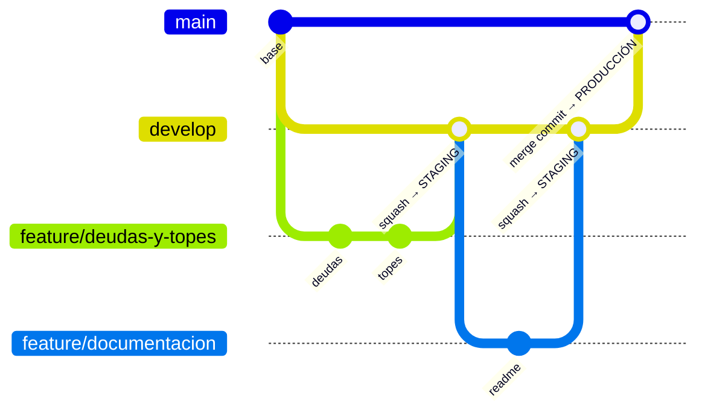
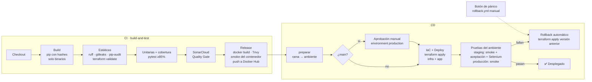
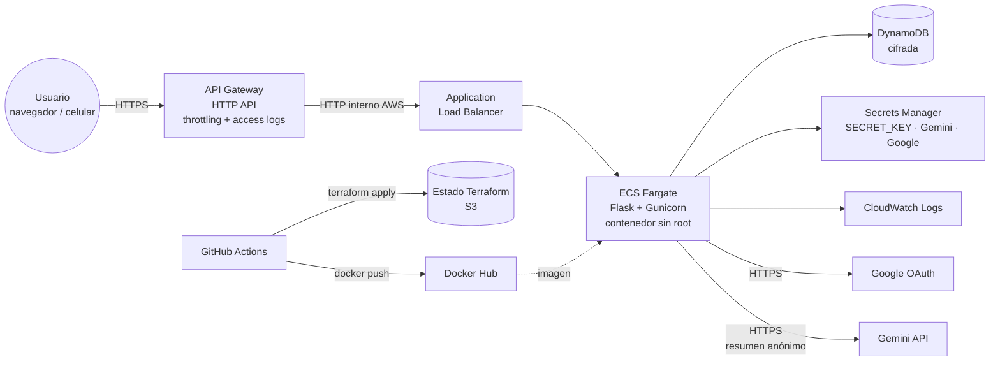

# Kuadra — Tus cuentas, en orden

> Proyecto final · Integración Continua · Universidad EAFIT · Presentación: **sábado 21 de noviembre de 2026**

Kuadra es una web-app de **finanzas personales y compartidas** con un **asesor financiero con IA**,
desplegada en AWS con un pipeline completo de CI/CD en GitHub Actions.

| Ambiente | URL | Rama | Cómo entrar |
|---|---|---|---|
| **Staging** | https://gltnljvybb.execute-api.us-east-1.amazonaws.com | `develop` | "Probar la demo" o Google |
| **Producción** | https://i7zjonfg9h.execute-api.us-east-1.amazonaws.com | `main` | Google (solo usuarios de prueba) |

---

## Índice

1. [El artefacto de software](#1-el-artefacto-de-software)
2. [Estrategia de ramificación](#2-estrategia-de-ramificación)
3. [Diseño del pipeline CI/CD](#3-diseño-del-pipeline-cicd)
4. [Integración de ramas y pipelines](#4-integración-de-ramas-y-pipelines)
5. [Arquitectura de software](#5-arquitectura-de-software)
6. [Pruebas implementadas](#6-pruebas-implementadas)
7. [Evidencia de pipelines exitosos](#7-evidencia-de-pipelines-exitosos)
8. [Las tres modificaciones](#8-las-tres-modificaciones-de-pipeline-y-arquitectura)
9. [Demostración por ambiente](#9-demostración-de-la-app-en-cada-ambiente)
10. [Desafíos y aprendizajes](#10-desafíos-y-aprendizajes)
11. [Guía para el equipo](#11-guía-para-el-equipo)

---

## 1. El artefacto de software

### Propósito
Ayudar a una persona a **ordenar su plata** y a **cuadrar cuentas con su familia, pareja o roommates**
sin exponer sus finanzas personales: *lo tuyo es tuyo, lo compartido, claro.*

### Funcionalidades
| Módulo | Qué hace |
|---|---|
| **Cuenta** | Inicio de sesión / registro con Google (OAuth 2.0 + PKCE), nombre y foto de perfil |
| **Gastos personales** | Registrar gastos, ingresos y retiros por categoría y medio de pago |
| **Análisis** | Balance del mes, dona por categoría, tendencia de 6 meses, gastos de la semana |
| **Deudas y topes** | Registrar deudas (orden de pago: tasa más alta primero) y topes mensuales con alertas |
| **Compartido** | Grupos por correo, gastos divididos, "quién le debe a quién", transferencias ("Sara le pagó a Manuela") |
| **Asesor IA** | Chat fijo con **Gemini** que responde con tono firme usando un resumen anónimo de las finanzas; respaldo por reglas si la IA falla |

### Complejidad (componentes)
| Componente | Tecnología |
|---|---|
| Aplicación web | Python 3.13 · Flask · Gunicorn · contenedor Docker en **ECS Fargate** |
| Entrada HTTPS | **API Gateway (HTTP API)** → **Application Load Balancer** |
| Base de datos | **DynamoDB** (diseño de una sola tabla PK/SK) |
| Secretos | **AWS Secrets Manager** |
| Servicios externos | **Google OAuth** (identidad) y **Gemini API** (asesor) |
| Infraestructura | **Terraform** (estado en S3, un workspace por ambiente) |

---

## 2. Estrategia de ramificación

**GitFlow simplificado** con dos ramas permanentes y ramas temporales por funcionalidad:



| Rama | Propósito | Ambiente | Cómo entra el código |
|---|---|---|---|
| `feature/*`, `fix/*` | Una funcionalidad o corrección | — (solo CI) | Commits del desarrollador |
| `develop` | Integración del equipo | **Staging** | PR desde `feature/*` con **squash merge** |
| `main` | Versión estable | **Producción** | PR desde `develop` con **merge commit** + aprobación |

**¿Por qué esta estrategia?**
- **Cada ambiente tiene una rama** que lo representa: es fácil saber qué versión corre en cada lugar.
- **Producción solo recibe código ya probado en staging** (pruebas de aceptación en AWS real).
- **Squash en features** deja un commit limpio por funcionalidad; **merge commit en `develop → main`**
  mantiene sincronizadas las ramas permanentes (con squash aparecen conflictos falsos; nos pasó en el PR #2).
- Las reglas **no dependen de la disciplina del equipo**: GitHub las hace cumplir (*Rulesets*):

| Regla (Settings → Rules → Rulesets) | `main` | `develop` |
|---|---|---|
| Push directo | Bloqueado (solo PR) | Bloqueado (solo PR) |
| Requisito para fusionar | Commit **desplegado y probado en `staging`** (*required deployments*); no corre pipeline en el PR | CI `build-and-test` en verde |
| Aprobación de un compañero | 1 obligatoria | Opcional |
| Tipo de merge | Solo merge commit | Squash o merge |
| Rama actualizada antes de merge | Sí | — |
| Borrar rama / force push | Bloqueado | Bloqueado |
| Despliegue | Aprobación manual (*environment* `production`) | Automático a staging |

---

## 3. Diseño del pipeline CI/CD

Un solo workflow, [`.github/workflows/ci.yml`](.github/workflows/ci.yml) (**CI/CD**), con 5 jobs,
y un workflow manual, [`.github/workflows/rollback.yml`](.github/workflows/rollback.yml) (**botón de pánico**).



| Etapa | Paso | Herramienta | Qué garantiza |
|---|---|---|---|
| **CI** | Checkout | `actions/checkout` (fijada por SHA) | Código exacto del commit |
| | Build | `pip --require-hashes --only-binary=:all:` | Dependencias reproducibles, sin scripts de instalación |
| | Test estáticas | **ruff** | Estilo, errores y reglas de seguridad (bandit) |
| | | **gitleaks** | Ningún secreto en el historial |
| | | **pip-audit** | Dependencias sin vulnerabilidades conocidas |
| | | **terraform fmt / validate** | IaC bien formada |
| | | **SonarCloud** | Calidad, seguridad y Quality Gate (exigido en `main`) |
| | Test unitarias + cobertura | **pytest + pytest-cov** | 133 pruebas, cobertura ~97% (mínimo 85%) |
| | Release | **Docker** + **Trivy** | Imagen sin vulnerabilidades HIGH/CRITICAL, publicada en Docker Hub con el SHA |
| **CD** | IaC + Deploy infra | **Terraform** (backend S3, workspaces) | DynamoDB, ECS, ALB, API Gateway, Secrets Manager por ambiente |
| | Deploy app | **ECS Fargate** (circuit breaker) | Nueva versión sin caída; ECS revierte si no arranca |
| | Tests pre-prod | **pytest + requests + Selenium** | Flujos completos en staging |
| | Tests post-prod | **pytest + requests** | Smoke tests en producción |
| | Rollback | **Terraform** con la imagen anterior | Automático si fallan las pruebas; manual con `rollback.yml` |

---

## 4. Integración de ramas y pipelines

| Evento | Qué se ejecuta | Ambiente |
|---|---|---|
| Push a `feature/*` | Nada (se valida en el PR) | — |
| **PR → `develop`** | CI completo (sin desplegar) + análisis de Sonar en el PR | — |
| **Merge a `develop`** | CI → IaC → deploy → smoke + aceptación + Selenium → rollback si fallan | **Staging** |
| **PR `develop` → `main`** | **No corre pipeline.** La regla de `main` exige que ese commit tenga el despliegue `staging` en verde (lo marca el job de pruebas solo si smoke + aceptación + Selenium pasan) + 1 aprobación | — |
| **Merge a `main`** | CI + Quality Gate de Sonar **sin reconstruir la imagen**: se **promueve** la imagen ya probada en staging (la del 2.º padre del merge commit, *build once, deploy many*) + Trivy → **aprobación manual** → IaC → deploy → smoke → rollback si fallan | **Producción** |
| Manual `ci.yml` (*Run workflow*) | Igual que el push de la rama elegida (útil si el último commit de `develop` solo tocó docs y no se desplegó en staging) | Según la rama |
| Manual (`workflow_dispatch`) | `rollback.yml`: ambiente + versión (o la anterior) | Staging o Producción |

---

## 5. Arquitectura de software



- **Un stack por ambiente** (workspaces `staging` y `production`): bases de datos, secretos y URLs separados.
- **Datos (una sola tabla DynamoDB):** `USER#correo` (perfil, movimientos, deudas, topes, foto, índice de grupos)
  y `GRUPO#id` (miembros, gastos, pagos).
- **Seguridad:** HTTPS en la entrada, HSTS, CSP estricta, cookies `Secure`/`HttpOnly`/`SameSite`, CSRF en todos los
  formularios, control de acceso por grupo, secretos fuera del código, contenedor sin root, imagen sin `pip`.
- Código en [`infra/`](infra/) y app en [`app/`](app/).

---

## 6. Pruebas implementadas

| Tipo | Archivo(s) | Ambiente | Qué valida y por qué |
|---|---|---|---|
| **Estáticas** | ruff, gitleaks, pip-audit, Sonar, terraform validate, Trivy | CI | Defectos y vulnerabilidades antes de ejecutar nada |
| **Unitarias de dominio** | `tests/test_dominio.py` | CI | Cálculos de dinero: categorías, topes, división de gastos con residuos, simplificación de deudas, orden avalancha, validación de correos |
| **Asesor IA** | `tests/test_asesor.py` | CI | Responde "No" ante compras con deudas caras; usa solo datos del resumen; Gemini simulado (formato, clave en cabecera, errores) |
| **Integración web** | `tests/test_rutas.py`, `test_grupos_y_registro.py`, `test_pagos_y_perfil.py`, `test_finanzas.py` | CI | Rutas Flask completas: registro, grupos por correo, quién ve qué, transferencias, foto (tipos reales, tamaño), deudas y topes |
| **Seguridad** | varias | CI | CSRF, XSS escapado, redirecciones abiertas, acceso a grupos ajenos (404), cookie del chat < 4 KB |
| **Login Google** | `tests/test_google_auth.py` | CI | PKCE, `state`, cancelación, correo no verificado (Google simulado) |
| **DynamoDB** | `tests/test_almacen_dynamo.py` | CI | Mismo comportamiento con DynamoDB simulado (moto) |
| **Entrada de pruebas** | `tests/test_login_pruebas.py` | CI | Solo existe en staging, con token y CSRF |
| **Aceptación multiusuario (pre-prod)** | `e2e/test_aceptacion_staging.py` | **Staging** | App real en AWS: Manu crea grupo e invita a Ana → Ana lo ve → gasto dividido → "Debes $50.000" → transferencia → paz y salvo; un intruso no ve el grupo; Gemini responde |
| **UI con Selenium (pre-prod)** | `e2e/test_ui_selenium.py` | **Staging** | Un navegador real entra a la demo y registra un gasto |
| **Smoke (post-prod)** | `e2e/test_smoke.py` | **Staging y Producción** | HTTPS, versión desplegada = commit, cabeceras de seguridad, cookie segura, rutas protegidas, **en producción no hay demo ni entrada de pruebas** |

**¿Por qué el login real de Google no se automatiza?** Google bloquea los inicios de sesión robóticos y no es
seguro guardar contraseñas en el CI. Se prueba **simulado en CI**, con una **entrada controlada solo en staging**
(token secreto, correos `@pruebas.kuadra.app`) y la **redirección** en los smoke tests.

---

## 7. Evidencia de pipelines exitosos

| Pipeline | Enlace |
|---|---|
| Producción (`main`): CI → aprobación → deploy → smoke | https://github.com/manujimeneza/cicd-project-final-app/actions/runs/44399078388 |
| Staging (`develop`): CI → deploy → smoke + aceptación + Selenium | https://github.com/manujimeneza/cicd-project-final-app/actions/runs/44403547197 |
| Pull requests | https://github.com/manujimeneza/cicd-project-final-app/pulls?q=is%3Apr |
| SonarCloud | https://sonarcloud.io/project/overview?id=manujimeneza_cicd-project-final-app |

> Capturas para la presentación: ver [§11 Pendientes](#pendientes-para-la-presentación).

---

## 8. Las tres modificaciones de pipeline y arquitectura

| # | Modificación | Respecto a lo visto en clase | Evidencia |
|---|---|---|---|
| **1** | **HTTPS con API Gateway delante del ALB** | En clase el ALB exponía HTTP. Google OAuth exige HTTPS y AWS Academy no permite CloudFront: API Gateway da HTTPS sin dominio propio, con *throttling* y *access logs*. | `infra/main.tf` (`aws_apigatewayv2_*`), smoke `test_url_es_https` |
| **2** | **Componentes serverless de datos y secretos: DynamoDB + Secrets Manager** | En clase la app no tenía estado. Ahora persiste en DynamoDB cifrada (una tabla por ambiente) y las claves se inyectan desde Secrets Manager. | `infra/main.tf`, `app/almacen.py`, `tests/test_almacen_dynamo.py` |
| **3** | **DevSecOps en el pipeline** | Se agregan **gitleaks**, **pip-audit**, **Trivy**, **terraform validate**, actions fijadas por **SHA**, instalación solo de binarios y Quality Gate de Sonar. Trivy encontró vulnerabilidades reales (zlib y pip) y se corrigieron. | `ci.yml`, `Dockerfile`, historial de Sonar |

**Extras:** pruebas de aceptación **multiusuario** en AWS real, aprobación manual de producción, **rollback automático
+ botón de pánico** con Terraform, *Rulesets* de GitHub y asesor con **IA generativa (Gemini)**.

---

## 9. Demostración de la app en cada ambiente

**Staging** (https://gltnljvybb.execute-api.us-east-1.amazonaws.com) — etiqueta amarilla `staging`:
1. "Probar la demo" (o Google) → registrar nombre → "Hola, …".
2. **＋ Agregar** un gasto → aparece en el inicio y en **Análisis**.
3. **Deudas y topes**: agregar una deuda al 28% y un tope de Mercado.
4. Preguntar al **asesor**: "¿Puedo comprarme unos zapatos?" → responde "No…" con los números.

**Producción** (https://i7zjonfg9h.execute-api.us-east-1.amazonaws.com):
1. "Iniciar sesión con Google" con una cuenta de prueba → nombre → inicio vacío (base de datos separada de staging).
2. **Compartido → + Nuevo grupo**, invitar el correo de un compañero.
3. El compañero entra desde su celular, ve el grupo; registrar un gasto dividido → "Te deben…".
4. **Marcar pagado** → "A paz y salvo".
5. Mostrar `/health` con la versión (= SHA del commit en `main`).

---

## 10. Desafíos y aprendizajes

| Desafío | Qué aprendimos / cómo se resolvió |
|---|---|
| AWS Academy **no permite CloudFront** y Google exige HTTPS | API Gateway HTTP API como entrada HTTPS (modificación #1) |
| SonarCloud: *Automatic Analysis* chocaba con el análisis del CI | Desactivarlo y analizar solo desde el pipeline |
| El plan gratuito de Sonar no da Quality Gate fuera de `main` | Exigirlo solo en `main` |
| **Trivy** bloqueó la imagen por vulnerabilidades HIGH | Parchear el sistema base y quitar `pip` de la imagen final |
| Sonar marcó *actions* sin SHA, `pip` sin `--only-binary`, regex lenta | Actions fijadas por SHA, binarios con hashes, validación de correo sin regex |
| Un `:all: ` dentro de YAML rompió el workflow sin ejecutar nada | Validar los YAML antes de subir |
| `workflow_run` usa el workflow de la rama por defecto | CI y CD en un mismo workflow |
| El **squash** de `develop → main` generó conflictos falsos | Squash solo para features; merge commit entre ramas permanentes (y forzado por Rulesets) |
| Smoke tests fallaron en producción por diferencias con staging (sin demo, CSRF) | Las pruebas deben reflejar la configuración de cada ambiente |
| El login de Google no se puede automatizar | Simulación en CI + entrada de pruebas solo en staging + validación de la redirección |
| La cookie de sesión podía superar 4 KB con el chat | Limitar el historial guardado |

---

## 11. Guía para el equipo

### Flujo de trabajo
```bash
git switch develop && git pull
git switch -c feature/mi-cambio
# ... cambios + pruebas ...
ruff check . && pytest
git push -u origin feature/mi-cambio
gh pr create --base develop          # o desde GitHub; luego "Squash and merge"
```
Para producción: PR `develop → main` → **Create a merge commit** → en Actions, **Review deployments → production → Approve**.

### Correr localmente
```bash
python3.13 -m venv .venv && . .venv/bin/activate
pip install --require-hashes --only-binary=:all: -r requirements-dev.txt
pytest                                   # pruebas unitarias e integración
flask --app app:create_app --debug run   # http://localhost:5000 → "Probar la demo"
```
Opcional: `GEMINI_API_KEY=...` (asesor con IA), `GOOGLE_CLIENT_ID/SECRET` + `URL_PUBLICA=http://localhost:5000` (login Google).

### Secretos y variables de GitHub
| Nombre | Tipo | Uso |
|---|---|---|
| `AWS_ACCESS_KEY_ID`, `AWS_SECRET_ACCESS_KEY`, `AWS_SESSION_TOKEN` | Secret | Terraform. **Vencen con cada sesión de AWS Academy**: actualizarlos antes de desplegar |
| `DOCKERHUB_TOKEN` / `DOCKERHUB_USERNAME` | Secret / Variable | Publicar la imagen |
| `SONAR_TOKEN` / `SONAR_HOST_URL` | Secret / Variable | SonarCloud |
| `GEMINI_API_KEY` | Secret | Asesor con IA |
| `GOOGLE_CLIENT_ID`, `GOOGLE_CLIENT_SECRET` | Secret | Login con Google |
| `TOKEN_PRUEBAS` | Secret | Entrada de pruebas automáticas (solo staging) |

### Rollback manual (botón de pánico)
Actions → **Rollback (botón de pánico)** → *Run workflow* → ambiente → versión (SHA) o vacío para la anterior.

### Pendientes para la presentación
- [ ] **Capturas** (carpeta compartida del equipo): pipeline de producción en verde, aprobación de `production`,
      pipeline de staging con aceptación y Selenium, Sonar (Quality Gate en verde y hotspots revisados),
      Rulesets, DynamoDB con las dos tablas, la app en cada ambiente.
- [ ] **Diapositivas** siguiendo las secciones 1 a 10 de este README (los diagramas Mermaid se pueden exportar desde GitHub).
- [ ] **Demostrar un rollback**: ejecutar el botón de pánico en staging y mostrar `/health` con la versión anterior.
- [ ] Agregar los correos del equipo y del profesor como **usuarios de prueba** en Google Cloud (OAuth).
- [ ] **Antes de presentar:** encender AWS Academy y actualizar los 3 secretos de AWS.
- [ ] Ensayar la demo de la §9 con dos personas (grupo compartido en vivo).
- [ ] Repartir quién presenta cada sección.
